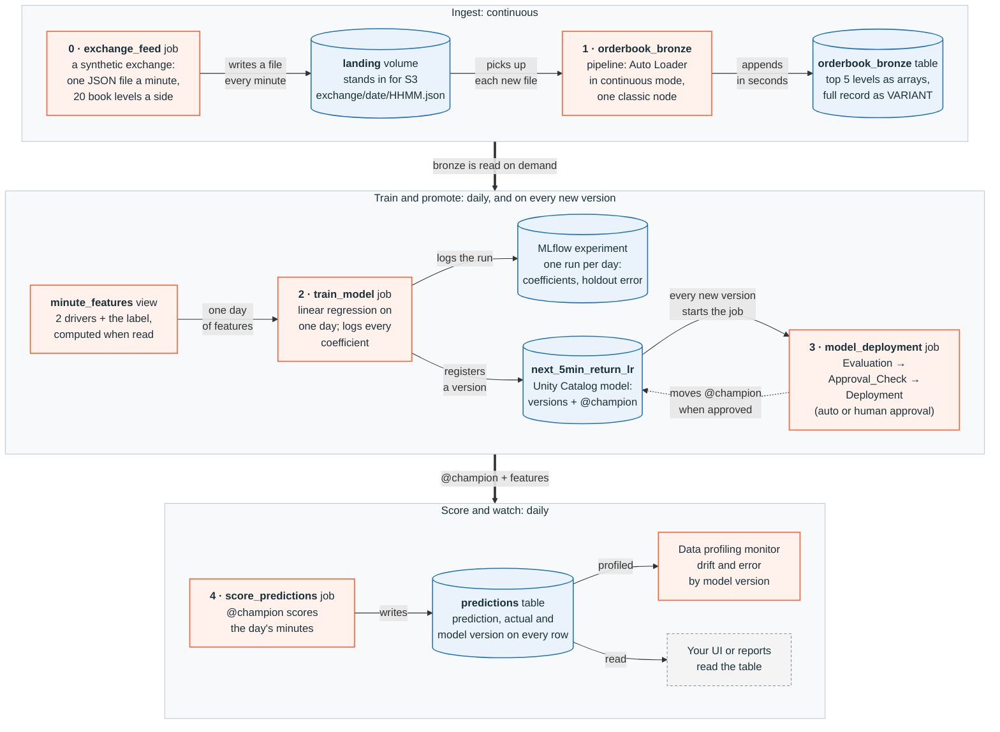

# orderbook-ml-starter

**Last updated:** 2026-11-23

A small, working Databricks project that runs the whole loop on synthetic order book data. Snapshots land as files every
minute, a continuous pipeline appends them to a bronze table, a daily job retrains a model and records every coefficient, a
deployment job decides whether the new version goes live, and the live version scores each day into a table that is monitored
for drift. Every piece is kept to its simplest working form so the project can be read in one sitting and copied; it is a base
to build on, not a production system. It deploys as one Declarative Automation Bundle (formerly Databricks Asset Bundle).

Using a coding tool to deploy it? Point it at [`AGENT.md`](AGENT.md) first.

## Architecture



If the diagram doesn't render where you are reading this, open [`docs/architecture.png`](docs/architecture.png).

Orange boxes run code (the jobs, the pipeline and the monitor) and blue cylinders hold data (a volume, tables, the MLflow
experiment and the Unity Catalog model). Only the first row runs all the time; everything else runs once a day, or when a new
model version appears.

## Components at a glance

| # | Component | What it does | Runs on | When | Files |
|---|-----------|--------------|---------|------|-------|
| 0 | `exchange_feed` job | Pretends to be one exchange: writes one JSON file a minute with the order book of 3 corridors | Serverless | Continuous while unpaused (paused by default) | `src/feed/exchange_feed.py` |
| 1 | `orderbook_bronze` pipeline | Auto Loader appends every new file to the bronze table | Classic, one node | Continuous | `src/orderbook_bronze/transformations/orderbook_bronze.sql` |
| 1 | `minute_features` view | Turns each snapshot into the model's two inputs and the value to predict | Nothing runs | Computed when read | `src/training/minute_features.sql` |
| 2 | `train_model` job | Creates the view and the model if needed, trains on one day, logs every coefficient, registers a version | Serverless | Daily at 00:30 UTC (schedule paused) | `src/training/setup.py`, `src/training/train.py` |
| 3 | `model_deployment` job | Compares each new version with `@champion`, waits for approval when needed, moves `@champion` | Serverless | On every new model version | `src/deployment/*.py` |
| 4 | `score_predictions` job | `@champion` scores one day into `predictions`; creates the data profiling monitor | Serverless | Daily at 01:00 UTC (schedule paused) | `src/scoring/score.py` |

Each component's job or pipeline definition is in `resources/` (one YAML file per component, plus `schema.yml` for the
schema, the landing volume and the experiment). The schedules ship paused because the data is synthetic: you run the jobs by
hand (see [Deploy and run](#deploy-and-run)).

## How each piece works

### 0 · Exchange feed (synthetic)

- It stands in for the producers that write to S3 (for example AWS Lambda functions). Every minute it writes
  `landing/exchange_1/<YYYY-MM-DD>/<HHMM>.json`, one JSON line per corridor (`USD-MXN`, `USD-BRL`, `USD-PHP`, illustrative)
  with `exchange`, `ticker`, `ts`, and `bids` and `asks` as 20 `[price, size]` pairs a side.
- On its first start the folder is empty, so it writes three days at once from midnight UTC, then one file a minute. After a
  pause it carries on from the last file, so no minute is ever missing and prices continue where they stopped.
- The data has known effects planted in it: each minute, the spread and the order imbalance move the price over the
  following minutes by fixed amounts, plus random noise. **From the third day the spread's effect flips sign**, which gives
  the training and deployment steps a market change to detect. Because the true values are known, you can check that the
  model finds them (section 2).
- It is a continuous job: unpausing starts it and pausing (plus cancelling the run) stops it. `scripts/live.sh` does both.

### 1 · Bronze pipeline

The whole pipeline is one SQL statement:

```sql
CREATE OR REFRESH STREAMING TABLE orderbook_bronze
COMMENT 'One-minute order book snapshots: the top 5 levels parsed, the full book kept as raw VARIANT'
AS SELECT raw:exchange::string AS exchange, raw:ticker::string AS ticker, raw:ts::timestamp AS ts,
  transform(slice(raw:bids::array<array<double>>, 1, 5), l -> named_struct('price', l[0], 'size', l[1])) AS bids,
  transform(slice(raw:asks::array<array<double>>, 1, 5), l -> named_struct('price', l[0], 'size', l[1])) AS asks,
  raw, _metadata.file_path AS source_file, current_timestamp() AS ingested_at
FROM STREAM read_files('${landing_path}', format => 'json', singleVariantColumn => 'raw');
```

- `read_files` in a streaming table is Auto Loader: each new file is picked up exactly once.
- The pipeline runs in **continuous** mode on one small classic node (single node, `r5d.xlarge`, on demand, Core edition, no
  Photon). Files reach bronze about 4 to 5 seconds after their minute, with no job, trigger or schedule in between.
- Each row keeps the top 5 levels a side as arrays of `{price, size}` and the whole line as `raw` (VARIANT), so deeper levels
  stay one expression away (`raw:bids[7][0]::double`) and the landing files can expire. `source_file` and `ingested_at` trace
  every row back to its file.
- One pipeline serves every exchange. A new exchange with the same format is a new folder under `landing/`; one with a
  different format is one more SQL file with a flow into the same table.
- In production, turn on file events on the S3 external location; the pipeline's event log advises it for continuous mode with
  directory listing.

### 1 · Features view

`minute_features` turns each bronze row into the model's inputs and the value to predict:

- `mid` is the average of the best bid and the best ask;
- `spread_bps` and `order_imbalance` are the two inputs (explained in section 2);
- `next_5min_return_bps` is how much the mid price moves over the next 5 minutes, kept only when the snapshot 5 minutes later
  exists.

The inputs use only the snapshot at `ts`; only the value to predict looks ahead, so nothing leaks from the future. A view costs
nothing until it is read. If it gets heavy at real volumes, materialize it in a separate triggered pipeline, never in the
continuous one.

### 2 · Training: what the model does

**In one sentence:** every minute, for each corridor, the model looks at two numbers in the order book and estimates how much
the price will move over the next 5 minutes.

| Name | Role | What it measures | Range here |
|------|------|------------------|------------|
| `spread_bps` | input | The gap between the cheapest offer to sell and the highest bid to buy, as a share of the price, in basis points (1 bp = 0.01%). A wider gap means trading is more expensive right now. | 0.5 to 3.5 bps |
| `order_imbalance` | input | The balance between size waiting to buy and size waiting to sell in the top 5 levels: +1 means everything is on the buy side, -1 everything on the sell side, 0 balanced. | -1 to +1 |
| `next_5min_return_bps` | output | How much the mid price actually moved over the next 5 minutes, in bps. This is what the model learns to predict. | A few bps either way |

The model is a **linear regression**, the simplest model there is:

```text
predicted move (bps) = intercept + coef.spread_bps × spread_bps + coef.order_imbalance × order_imbalance
```

Training means finding the three numbers (two weights and a starting value) that make the predictions as close as possible to
what really happened. Because there are only three numbers, anyone can read what the model has learned.

**A worked example** with the first day's model (`coef.spread_bps` +0.40, `coef.order_imbalance` 0.78, `intercept` -0.70):
for a minute with a 3 bps spread and an imbalance of +0.5, the prediction is -0.70 + 0.40 × 3 + 0.78 × 0.5 = **+0.89 bps**,
so the model expects the price to be about 0.9 bp higher in 5 minutes.

**How a day is trained.** The job takes one day of the view. The first 18 hours (00:00 to 17:59 UTC) are used to learn and
the last 6 hours (18:00 to 23:59) are kept aside to test, because a daily job can't test on tomorrow. That is about 3,240
training rows and 1,080 test rows (3 corridors × 60 minutes × 18 or 6 hours). The inputs are every column of the view except
the keys and the output, so changing the view changes the model without touching `train.py`.

**What each run records**, in the MLflow experiment (one run per training day) and on the Unity Catalog model version:

| Name | Kind | What it means | How to read it |
|------|------|---------------|----------------|
| `coef.spread_bps` | metric | How many bps the predicted move changes for each extra bp of spread, with the imbalance unchanged | The sign is the direction (positive: a wider spread is followed by the price going up) and the size is the strength |
| `coef.order_imbalance` | metric | How many bps the predicted move changes when the book goes from balanced (0) to all on the buy side (+1) | Positive: buying pressure is followed by the price going up |
| `intercept` | metric | The starting value the two effects are added to, that is the prediction when both inputs are 0 | A spread of 0 never happens, so on its own it means little: it shifts the line so the average prediction matches the average move |
| `holdout_mae` | metric | Mean absolute error on the 6 test hours: on average, how far the predictions were from what happened, in bps | The one value where lower is better |
| `train_end_ts` | metric | The last training minute, as a Unix timestamp | Only there so charts can put training days on the X axis |
| `train_date`, `rows_train`, `rows_holdout` | params | The day trained on, and how many rows went into learning and testing | Fewer rows than usual means data was missing that day |

The model version also carries a `train_date` tag, and the deployment job adds an `evaluation` tag (and `Approval_Check` once
approved).

#### Higher or lower: which is better?

Only `holdout_mae` has a better direction: **lower is better**, because the predictions were closer to what happened. The
coefficients are not scores. A higher or lower coefficient is not better or worse; it describes how the market behaved that day.

| Value | Better when | Warning sign |
|-------|-------------|--------------|
| `holdout_mae` | Lower | It rises from one version to the next. The deployment job holds a version that is more than 5% worse than `@champion`. |
| `coef.spread_bps`, `coef.order_imbalance` | Stable from one day to the next. The size says how much that input matters; a value close to 0 means the input adds little. | The sign flips (the market now behaves the other way; the deployment job holds the version for a person) or the value swings a lot between days |
| `intercept` | Neither: it only balances the formula | None on its own |
| `train_end_ts`, row counts | Neither | Row counts lower than usual |

On this synthetic data the true effects are known, so "right" for a coefficient means close to them:

| Version | Day | `coef.spread_bps` (true value) | `coef.order_imbalance` (true value) | `holdout_mae` |
|---------|-----|-------------------------------:|------------------------------------:|--------------:|
| v1 | day 1 | +0.40 (+0.40) | 0.78 (0.80) | 1.29 |
| v2 | day 2 | +0.39 (+0.40) | 0.78 (0.80) | 1.29 |
| v3 | day 3 | -0.44 (-0.40) | 0.75 (0.80) | 1.28 |

An error of about 1.3 bps is close to the best any model can do here: the feed adds random moves, and the price also reacts to
the next few minutes' spread and imbalance, which no input at the time of the prediction can know.

**Coefficients over time.** In the experiment's Chart view, plot `coef.spread_bps` with `train_end_ts` on the X axis: it stays
near +0.4 for two days, then drops to near -0.4. For a table instead of a chart, `mlflow.search_runs` returns every metric of
every run.

### 3 · Deployment job (MLflow 3 deployment job, Public Preview)

`setup.py` links the job to the Unity Catalog model, so every new version starts it with the model name and version. Versions
are checked one at a time, in order.

| Task | What it does |
|------|--------------|
| `Evaluation` | Scores the new version and `@champion` on the new version's 6 test hours, which neither model trained on. **The rule:** the new version's error is at most 5% worse than the champion's, and no coefficient changed sign. The result is written on the version as the `evaluation` tag, for example "MAE 1.283 vs champion v2 1.425; sign flip: spread_bps +0.39 → -0.44: rule failed, waiting for Approve". |
| `Approval_Check` | Passes once the version has the tag `Approval_Check = Approved`. The **Approve** button on the model version page sets it and repairs the run. |
| `Deployment` | Points the `@champion` alias at the version. Rolling back means pointing the alias at an older version. |

Whether a person is in the loop is one setting, the job parameter `approval_mode`:

| `approval_mode` | Rule passes | Rule fails |
|-----------------|-------------|------------|
| `auto` (default) | Approved by `Evaluation`, promoted with no person | Waits for **Approve** |
| `human` | Waits for **Approve** | Waits for **Approve** |

Approvers need `APPLY TAG` on the model and `CAN MANAGE RUN` on the deployment job. There is no serving endpoint: scoring loads
`@champion` directly.

### 4 · Scoring and monitoring

- `score_predictions` loads `@champion`, scores one day of `minute_features` (yesterday in UTC by default) and appends the rows
  to `predictions` with `prediction_bps`, `actual_bps`, `model_version` and `scored_at`. Rerunning a day with the same version
  replaces its rows; a day scored by two versions keeps both, for comparison.
- Performance over time, on real predictions rather than only on the test hours, is one query:

  ```sql
  SELECT to_date(ts) AS day, model_version, count(*) AS predictions,
         avg(abs(prediction_bps - actual_bps)) AS mae_bps
  FROM predictions GROUP BY ALL ORDER BY day;
  ```
- The first run creates a **data profiling monitor** (formerly Lakehouse Monitoring) on the table, in inference-log mode for a
  regression: prediction `prediction_bps`, label `actual_bps`, model id `model_version`, time `ts`, daily granularity. Each run
  refreshes it. Its metrics land in `predictions_profile_metrics` and `predictions_drift_metrics`, with a dashboard, so drift in
  the inputs and the predictions can be followed per model version.

## Design choices

- **Only bronze is continuous.** Minute freshness matters for landing the data; features, training, evaluation and scoring
  read bronze when they need it. The always-on part is one small node, whatever the volume.
- **Classic single node for the stream, serverless for the rest.** For one always-on stream a single classic node keeps the
  cost down; the jobs start on serverless and stop when done.
- **A view instead of silver and gold tables**, until it gets heavy enough to materialize in a triggered pipeline.
- **Predictions in a table.** A serving endpoint is only needed if a per-request prediction is ever required.
- **One rule a quant can read at a glance**, using only the logged coefficients, and **one setting** for a person in the loop.

## Data model

| Table | Columns |
|-------|---------|
| `orderbook_bronze` (streaming table) | `exchange`, `ticker`, `ts`, `bids` and `asks` (5 × `{price, size}`), `raw` (VARIANT, the whole line), `source_file`, `ingested_at` |
| `minute_features` (view) | `exchange`, `ticker`, `ts`, `spread_bps`, `order_imbalance`, `next_5min_return_bps` (empty for the last 5 minutes) |
| `predictions` (table) | `exchange`, `ticker`, `ts`, `spread_bps`, `order_imbalance`, `actual_bps`, `prediction_bps`, `model_version`, `scored_at` |

## Where everything lives

| Object | Name | Where |
|--------|------|-------|
| Schema, created by the bundle | `<schema>` (default `orderbook_ml_starter`) | `<catalog>` |
| Volume (stands in for S3) | `landing` | `<catalog>.<schema>` |
| Tables and view | `orderbook_bronze`, `minute_features`, `predictions`, the two monitor tables | `<catalog>.<schema>` |
| Unity Catalog model | `next_5min_return_lr` | `<catalog>.<schema>` |
| Pipeline and 4 jobs | `[orderbook-ml-starter] ...` | Workspace |
| Bundle files, MLflow experiment, monitor dashboard | `orderbook-ml-starter/` (`files/`, `experiment`, `monitoring/`) | `/Workspace/Users/<you>/` |

All data lives in one schema, so dropping the schema removes it all.

## Deploy and run

**Prerequisites:** a Unity Catalog workspace with serverless jobs and notebooks enabled; permission to create a schema in your
catalog, classic clusters for pipelines, and jobs; MLflow 3 deployment jobs available (Public Preview); PyPI access from
serverless (the notebooks install `mlflow>=3`); the Databricks CLI (tested with v1.21.0) for a laptop deploy.

**Configure** the defaults in `databricks.yml` (not with `--var`: the scripts redeploy without it):

```yaml
variables:
  catalog:   { default: <your catalog> }
  schema:    { default: <a new schema> }
  node_type: { default: r5d.xlarge }     # 4 vCPU / 32 GB; change it if not available
targets:
  dev:
    workspace:
      host: <your workspace URL>        # no profile here: pass --profile on the command line
```

`databricks.yml` has no profile on purpose, because the workspace authenticates the CLI from its environment and doesn't
support profiles. Locally, pass `--profile` to every command and export `PROFILE=<profile>` for the scripts.

**Deploy** from a laptop with `databricks bundle deploy --profile <profile>`, or from the workspace: clone this repository as a
Git folder, open it, and in the bundle editor's **Deployments** panel pick `dev` and click **Deploy**. Both are the same
deployment (same bundle name, target and user), so they update the same jobs and pipeline.

**Run:**

```bash
databricks bundle deploy --profile <profile>   # the first deploy creates everything and starts the pipeline
scripts/live.sh start                          # unpause the feed (and start the pipeline if it isn't running)
# when bronze has the three days, train them one at a time, oldest first:
databricks bundle run train_model --params train_date=<YYYY-MM-DD> --profile <profile>
# once the deployment job has promoted v2, score day 3:
databricks bundle run score_predictions --params score_date=<YYYY-MM-DD> --profile <profile>
scripts/live.sh stop                           # pause the feed and stop the pipeline
```

Train and score only complete days (UTC). Without parameters, both jobs use yesterday.

**Cost guard.** The feed and the pipeline run until they are stopped, and the pipeline is classic on-demand compute. Creating
the pipeline or changing its settings starts it; a redeploy that only changes SQL doesn't. **A deploy sets the feed job back to
paused, but a feed run already in progress keeps writing**, and `live.sh status` then reports `PAUSED`. Run
`scripts/live.sh stop` after every session (it also cancels the feed run) and check with `scripts/live.sh status`.

## Operate

- **Approve a waiting version:** open the version in Catalog Explorer and click **Approve**, or set the `Approval_Check` tag and
  repair the run with its `job_parameters` (and `latest_repair_id` if it was repaired before). A repair without parameters
  fails on purpose instead of promoting the wrong version.
- **Switch approval mode:** change `approval_mode` in the job's parameters in the Jobs UI, or deploy with
  `--var approval_mode=human`. While the feed is live, use the Jobs UI (a deploy re-pauses the feed job).
- **Reset to a known state:** `scripts/reset_demo.sh` (about 8 minutes) redeploys, deletes the model and the experiment's runs,
  empties `predictions`, trains the first three days again and scores the third. You end with `@champion` = v2 and v3 waiting
  for approval. Bronze and the landing files are kept. If it stops on an error, wait until `model_deployment` has no active run
  and run it again.
- **Change the file format or the bronze columns:** the feed fails on files in another format, and new columns need one full
  refresh:

  ```bash
  scripts/live.sh stop
  databricks fs rm -r dbfs:/Volumes/<catalog>/<schema>/landing/exchange_1 --profile <profile>
  databricks bundle deploy --profile <profile>
  databricks pipelines start-update <pipeline id> --full-refresh --profile <profile>
  scripts/live.sh start
  scripts/reset_demo.sh   # once bronze has caught up
  ```
- **Work from the workspace:** after a push, pull in the Git folder before deploying from it. The scripts also run in the
  web terminal (classic compute on Databricks Runtime 15.0 or above, enabled by an admin): `cd` into the Git folder and run
  `bash scripts/live.sh status`.
- **Use your own variables:** change the view (and, on synthetic data, the feed's planted effects). Training, deployment and
  scoring pick up the view's columns without changes.

## Before production

What this project leaves out on purpose:

- File events on the S3 external location.
- Fewer, larger files from the producers: one per exchange per minute, or batched by Amazon Data Firehose, which can also write
  Parquet.
- Running the jobs as a service principal, and deciding who may approve versions.
- Measuring one real day (bytes, files, run time) before sizing cost.
- A separate triggered pipeline for the features if the view gets heavy, and serving `@champion` behind a UI if a per-request
  prediction is ever needed.

<details>
<summary>What we observed on synthetic data (2026-11-22 and 23)</summary>

| Check | Result |
|-------|--------|
| Latency, file to bronze | 4.3 s on average, 4.6 s at most, over 27 live minutes |
| Completeness | 4,320 rows a day (3 corridors × 1,440 minutes), no gaps or duplicates; after a pause the feed filled the missed minutes |
| Pipeline cold start | 7 to 8 minutes for the classic cluster, then about 1 minute to load a backlog of several hours |
| Coefficients | Recovered the planted values (table in section 2) |
| Deployment job | v1 and v2 promoted automatically; v3 held on the sign flip; with `approval_mode = human`, a version that passed still waited |
| Scoring | 4,320 predictions per day; the error of v2 rose from 1.28 to 1.44 bps on the day the market changed |
| Deploy from a fresh clone | Reused the existing deployment: 0 created, 0 changed |

</details>

## Repository layout

```text
orderbook-ml-starter/
├── databricks.yml              # bundle: variables (catalog, schema, node_type, approval_mode) and the dev target
├── AGENT.md                    # instructions for coding tools
├── docs/architecture.mmd|png   # the diagram above
├── resources/                  # one YAML per component, plus schema.yml (schema, volume, experiment)
├── src/
│   ├── feed/exchange_feed.py                         # 0
│   ├── orderbook_bronze/transformations/orderbook_bronze.sql   # 1
│   ├── training/minute_features.sql, setup.py, train.py        # 1 and 2
│   ├── deployment/evaluation.py, approval_check.py, deployment.py   # 3
│   └── scoring/score.py                              # 4
└── scripts/live.sh, reset_demo.sh   # start, stop and check the live pieces; reset to a known state
```

## Documentation

- Ingestion and pipelines: [Auto Loader](https://docs.databricks.com/aws/en/ingestion/cloud-object-storage/auto-loader/) ·
  [`read_files`](https://docs.databricks.com/aws/en/sql/language-manual/functions/read_files) ·
  [Auto Loader file detection modes (file events)](https://docs.databricks.com/aws/en/ingestion/cloud-object-storage/auto-loader/file-detection-modes) ·
  [Ingest semi-structured data as VARIANT](https://docs.databricks.com/aws/en/ingestion/variant) ·
  [Triggered vs. continuous pipeline mode](https://docs.databricks.com/aws/en/ldp/pipeline-mode) ·
  [Configure classic compute for pipelines](https://docs.databricks.com/aws/en/ldp/configure-compute) ·
  [Serverless pipelines](https://docs.databricks.com/aws/en/ldp/serverless) ·
  [Flows: several sources into one table](https://docs.databricks.com/aws/en/ldp/flows) ·
  [Backfilling historical data](https://docs.databricks.com/aws/en/ldp/flows-backfill) ·
  [Continuous jobs](https://docs.databricks.com/aws/en/jobs/continuous)
- Models: [MLflow experiment tracking](https://docs.databricks.com/aws/en/mlflow/tracking) ·
  [MLflow Logged Models](https://docs.databricks.com/aws/en/mlflow/logged-model) ·
  [Models in Unity Catalog (versions, aliases)](https://docs.databricks.com/aws/en/machine-learning/manage-model-lifecycle/) ·
  [MLflow 3 deployment jobs](https://docs.databricks.com/aws/en/mlflow/deployment-job) ·
  [Data quality monitoring (data profiling)](https://docs.databricks.com/aws/en/data-quality-monitoring/)
- Deployment: [Declarative Automation Bundles](https://docs.databricks.com/aws/en/dev-tools/bundles/) ·
  [Bundles in the workspace](https://docs.databricks.com/aws/en/dev-tools/bundles/workspace) ·
  [Web terminal](https://docs.databricks.com/aws/en/compute/web-terminal)
